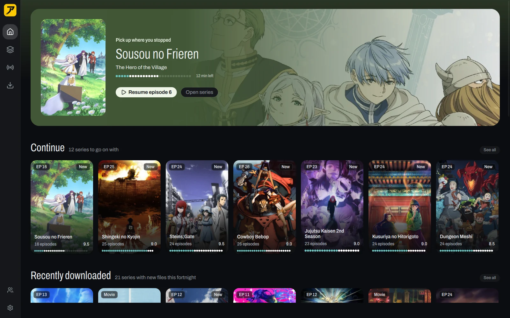
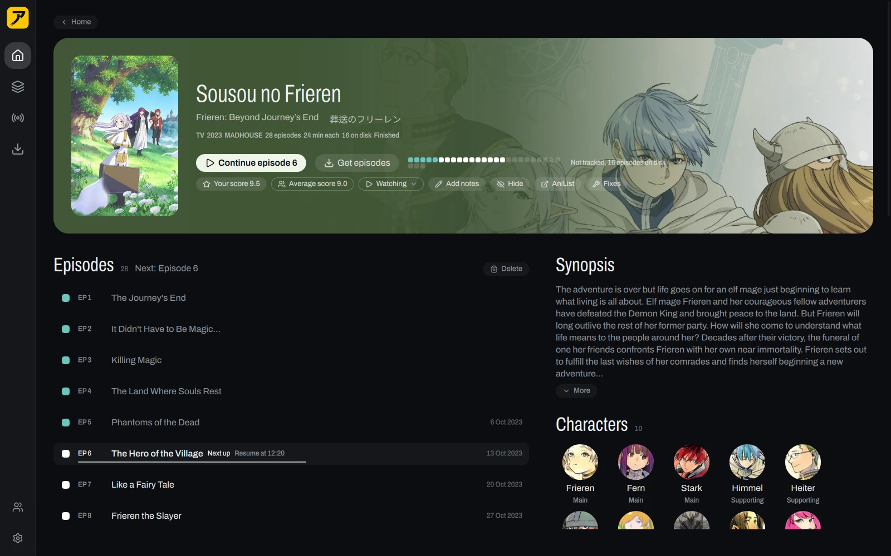
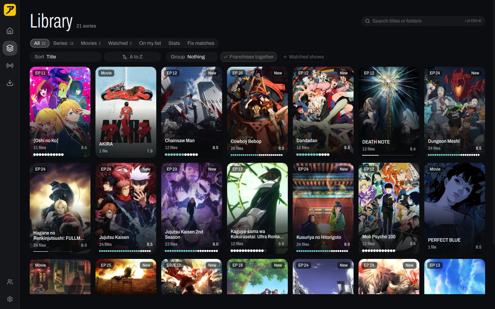
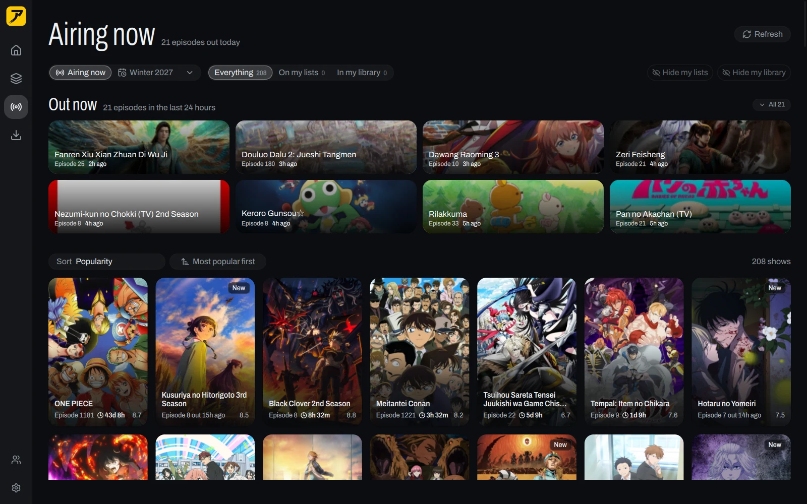
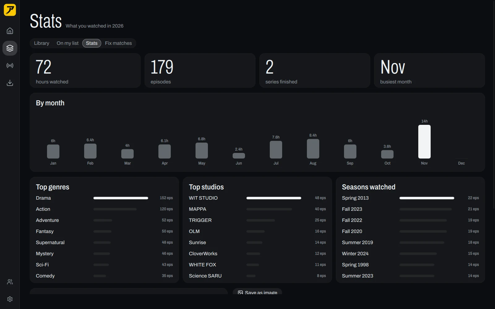

<div align="center">

<picture>
  <source media="(prefers-color-scheme: dark)" srcset="docs/readme/wordmark-dark.svg">
  
</picture>

<br>
<br>

**A local anime library, player, and tracker for desktop and mobile.**

**[anibeam.app](https://anibeam.app)** · **[Wiki](https://anibeam.app/wiki/)** · **[What's new](https://anibeam.app/whats-new/)** · **[Watch together](https://rooms.anibeam.app/)**

<br>

[](https://github.com/marcusbandit/Anibeam/releases/latest)
[](https://github.com/marcusbandit/Anibeam/releases)
[](https://github.com/marcusbandit/Anibeam/releases?q=android&expanded=true)
<br>
[](#install)
[](https://github.com/marcusbandit/Anibeam/releases)
[](LICENSE)
[](https://ko-fi.com/marcusbandit)

</div>

<br>

<div align="center">

</div>

<br>

Point Anibeam at your anime folder to organize, watch, and track your collection in one app.
It matches shows on AniList (with TVmaze as a fallback), fetches posters, episode lists, and
airing schedules, plays episodes with a built-in mpv player, and syncs your progress to
AniList and MyAnimeList.

No media server, account, or telemetry required. Desktop builds for Linux, Windows, and
Apple silicon Macs bundle the player and a built-in qBittorrent client for optional automatic
downloads. A standalone phone app is available for Android and iPhone (sideloaded).

## Features

- **Automatic library and matching:** Scans your folders, watches for new files, matches shows
  on AniList and TVmaze, fetches posters, IMDb scores, and airing times, and groups franchises
  together with a Related section on each show page.
- **Built-in mpv player and TV casting:** Remembers resume points, skips intros and outros
  (via AniSkip and chapter markers), supports custom subtitle styling and audio/subtitle
  delay, and casts to Chromecast and DLNA TVs.
- **Tracking, stats, and recommendations:** Two-way sync with AniList and MyAnimeList
  (progress, scores, list status, dates, rewatches, and notes), or local-only tracking without
  an account. Includes watching stats, year recap, personalized recommendations on Home, and
  Discord Rich Presence.
- **Watch together:** Start a synced room from any episode and invite up to 10 friends with a
  six-letter code, a `rooms.anibeam.app` link, a QR code, or Discord. Everyone plays their own
  copy in sync, with opening-based offset alignment and one-click episode fetching for friends
  who don't have the file yet.
- **Airing schedule and downloads:** Browse current and past seasons, export an iCal airing
  schedule, search releases across signed source lists you add (RSS, Torznab/Prowlarr/Jackett,
  and JSON), subscribe to airing shows, and use rolling downloads to keep long shows a few
  episodes ahead while optionally cleaning up watched files.
- **Themes and languages:** 35 built-in themes (including Catppuccin, Gruvbox, Tokyo Night,
  and Nord), dark/light/system mode, custom accent and text size, and 13 languages.
- **Phone app (Android and iPhone):** Runs standalone with its own library, built-in torrent
  engine, and libmpv playback, or streams from your computer over Tailscale with automatic
  transcoding and per-person progress.

<table>
  <tr>
    <td width="50%"></td>
    <td width="50%"></td>
  </tr>
  <tr>
    <td align="center"><sub>Series page</sub></td>
    <td align="center"><sub>Library</sub></td>
  </tr>
  <tr>
    <td width="50%"></td>
    <td width="50%"></td>
  </tr>
  <tr>
    <td align="center"><sub>Airing now</sub></td>
    <td align="center"><sub>Stats</sub></td>
  </tr>
</table>

## Install

Download from **[anibeam.app/download](https://anibeam.app/download/)** or **[GitHub Releases](https://github.com/marcusbandit/Anibeam/releases/latest)**.

| Platform | Install | Notes |
| --- | --- | --- |
| Linux & macOS (quick install) | `curl -fsSL https://anibeam.app/install.sh \| sh` | Uses AUR on Arch, apt on Ubuntu/Debian, dnf on Fedora, AppImage elsewhere, and Homebrew or `.dmg` on Apple silicon Macs. Prefix `sh` with `ANIBEAM_CHANNEL=nightly` for the latest nightly. |
| Arch Linux | `yay -S anibeam-bin` | Prebuilt AUR package (`yay -S anibeam` compiles from source). |
| Ubuntu / Debian | `sudo curl -fsSLo /etc/apt/sources.list.d/anibeam.sources https://anibeam.app/apt/anibeam.sources`<br>`sudo apt update && sudo apt install anibeam` | Ubuntu 24.04+, Debian 13+. Updates with `apt upgrade`. |
| Fedora | `sudo dnf config-manager addrepo --from-repofile=https://anibeam.app/rpm/anibeam.repo`<br>`sudo dnf install anibeam` | Fedora 41+. Updates with `dnf upgrade`. |
| Other Linux | `Anibeam-<version>-x86_64.AppImage` | Requires glibc 2.39+ (Ubuntu 24.04+, Debian 13+, Fedora 40+). Standalone `.deb` and `.rpm` packages are also attached to Releases. |
| Windows 10 / 11 | `Anibeam-<version>-windows-x64-setup.exe` | Per-user installer (no admin prompt). A portable `.zip` is also available. |
| macOS 15+ | `brew tap marcusbandit/anibeam https://github.com/marcusbandit/Anibeam`<br>`brew install --cask marcusbandit/anibeam/anibeam` | Apple silicon only. You can also download the `.dmg` and drag it into Applications. |
| Android 8+ | `Anibeam-<version>.apk` | Sideload from the latest `android` release. |
| iPhone (iOS 17+) | Add the Anibeam source in AltStore, SideStore, or LiveContainer (links below) | Unsigned IPA for sideloading; the sideloading app signs it. |

**iPhone sideloading:** Add the Anibeam source to get both Anibeam and Anibeam Nightly side by side with automatic updates:
[AltStore](https://anibeam.app/install/?to=altstore&source=1) · [SideStore](https://anibeam.app/install/?to=sidestore&source=1) · [LiveContainer](https://anibeam.app/install/?to=livecontainer&source=1)

<details>
<summary><b>iPhone</b>: install a single IPA without adding the source</summary>

<br>

- Stable: [AltStore](https://anibeam.app/install/?to=altstore&channel=stable) · [SideStore](https://anibeam.app/install/?to=sidestore&channel=stable) · [LiveContainer](https://anibeam.app/install/?to=livecontainer&channel=stable)
- Nightly: [AltStore](https://anibeam.app/install/?to=altstore&channel=nightly) · [SideStore](https://anibeam.app/install/?to=sidestore&channel=nightly) · [LiveContainer](https://anibeam.app/install/?to=livecontainer&channel=nightly)

If a channel has no IPA yet, the install page will say so.

</details>

<details>
<summary><b>macOS</b>: opening an unnotarized build for the first time</summary>

<br>

The Mac build is not notarized, so macOS blocks the first launch. Open **System Settings > Privacy & Security**, scroll to the Anibeam notice, and click **Open Anyway**, or run:

```bash
xattr -dr com.apple.quarantine /Applications/Anibeam.app
```

</details>

<details>
<summary><b>Windows</b>: SmartScreen warning on the unsigned installer</summary>

<br>

If Windows Defender SmartScreen prompts you, click **More info**, then **Run anyway**.

</details>

<details>
<summary><b>AppImage</b>: making it executable and FUSE notes</summary>

<br>

```bash
chmod +x ./*-x86_64.AppImage
./*-x86_64.AppImage
```

If it complains about FUSE, install `libfuse2` (`libfuse2t64` on Ubuntu 24.04) or launch with `--appimage-extract-and-run`.

</details>

AppImage, Windows, and macOS builds update themselves in-app (switch between Stable and Nightly in **Settings > About**). AUR, apt, and dnf installs update through your system package manager.

## Getting started

On first launch, Anibeam walks you through a short setup (every step is optional, and you can re-run it anytime under **Settings > About > Run setup again**):

1. **Add your library folder:** Pick the parent folder that holds your shows. One folder per show works best (`Anime/Sousou no Frieren/Frieren - 01.mkv`), and movies go in a `Movies` folder. Manage folders anytime in **Settings > Library**.
2. **Connect a tracker (optional):** Go to **Settings > Accounts** to sign in to AniList or MyAnimeList in your browser.
3. **Watch:** Click any show, then an episode. Press `?` in the player to see all keyboard shortcuts.
4. **Set up downloads (optional):** Anibeam ships with no download sources. Paste a signed source list URL in **Settings > Downloads > Source lists** (or directly on the **Downloads** page) to enable its sources, then click **Get episodes** on any show or search in **Downloads** to download or subscribe.

If a show isn't recognized or matched wrong, open it and click **Fixes > Match** (or review unmatched shows in **Library > Fix matches**). Misread episode files can be corrected under **Fixes > Files**.

<details>
<summary><b>More on downloads</b></summary>

<br>

Anibeam runs its own built-in search and subscription engine and bundles a headless qBittorrent client. The built-in client starts automatically when needed and stays running after you close Anibeam so subscriptions keep downloading.

By default, the built-in client saves episodes straight into your library folder (one folder per show, movies in `Movies`), so finished downloads show up in your library automatically. You can pick a different folder in **Settings > Downloads > Save to**.

To use your own qBittorrent instance (local, remote, or seedbox), enable its Web UI in qBittorrent (**Tools > Options > Web UI**), then go to **Settings > Downloads > Torrent client**, set **Which client** to **My own**, enter your address and login, and click **Save and test**. Make sure its download directory is added under **Settings > Library**.

See the [Downloads](https://anibeam.app/wiki/downloads/) and [Sources](https://anibeam.app/wiki/sources/) wiki pages for details on source lists and rolling downloads.

</details>

## Phone app and Tailscale streaming

The phone app for Android and iPhone works standalone with its own local library, built-in torrent engine, and libmpv playback, syncing to the same AniList or MyAnimeList account.

It can also browse and stream your computer's library from anywhere over [Tailscale](https://tailscale.com) with automatic transcoding and per-person progress: sign in to Tailscale on both devices, then turn on **Settings > Accounts > Phone app > Share over Tailscale** on your computer. Only devices on your tailnet can connect. To keep sharing when the desktop window is closed, run `anibeam serve` (or enable the `anibeam-host` systemd user service on Linux). See [apps/phone/README.md](apps/phone/README.md) for full details.

## Troubleshooting

<details>
<summary><b>qBittorrent won't connect</b></summary>

<br>

Open **Settings > Downloads > Torrent client**, click **Test**, and check **Details** for the exact error. If you want Anibeam to manage qBittorrent automatically, switch **Which client** to **Built-in** (or **Auto**) and save.

</details>

<details>
<summary><b>Tracker sign-in stays on "Finish in your browser"</b></summary>

<br>

Approve Anibeam in the browser tab it opened. If you closed that tab, click **Open the sign-in page again**.

</details>

<details>
<summary><b>Where Anibeam stores its data</b></summary>

<br>

| Platform | Data and config | Credentials | "Use my mpv.conf" reads |
| --- | --- | --- | --- |
| Linux | `~/.local/share/anibeam`, `~/.config/anibeam` | Secret Service keyring (or an owner-only file) | `~/.config/mpv/mpv.conf` |
| macOS | `~/Library/Application Support/anibeam` | macOS Keychain | `~/.config/mpv/mpv.conf` |
| Windows | `%LOCALAPPDATA%\anibeam`, `%APPDATA%\anibeam` | Windows Credential Manager | `%APPDATA%\mpv\mpv.conf` |

You can view the exact paths and export or restore a full backup in **Settings > About**.

</details>

Check the [Troubleshooting wiki](https://anibeam.app/wiki/troubleshooting/) for more fixes, or use **Settings > About > Report a problem** to [open an issue](https://github.com/marcusbandit/Anibeam/issues/new/choose) with your version pre-filled.

## Build from source

Run `./build.sh` from a checkout to build the desktop app. See [docs/build-from-source.md](docs/build-from-source.md) for dependencies, dev runs, and the CLI. Logos live in [assets/logo/](assets/logo/), and [CONTRIBUTING.md](CONTRIBUTING.md) covers issues, pull requests, and releases.

## Support

Anibeam is free and open source. If you get good use out of it and want to support development, you can buy me a coffee on [Ko-fi](https://ko-fi.com/marcusbandit). Completely optional, and starring the repo or filing good bug reports helps just as much.

<div align="center">

[](https://ko-fi.com/marcusbandit)

</div>

## Credits

- [AniList](https://anilist.co), [TVmaze](https://www.tvmaze.com), [IMDb](https://www.imdb.com), and [AniSkip](https://aniskip.com) for metadata, ratings, and skip times; [MyAnimeList](https://myanimelist.net) for tracking.
- [mpv](https://mpv.io) and KDE's [MpvQt](https://invent.kde.org/libraries/mpvqt) for video playback; [Qt](https://www.qt.io) (desktop) and [Slint](https://slint.dev) (mobile) for the UI.
- [qBittorrent](https://www.qbittorrent.org) and [librqbit](https://github.com/ikatson/rqbit) for downloads.

## License

[GPL-3.0](LICENSE).
