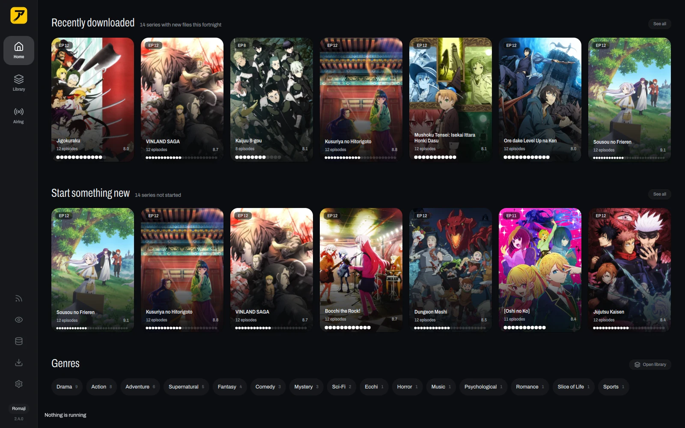
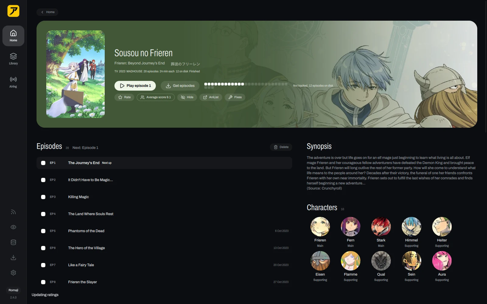
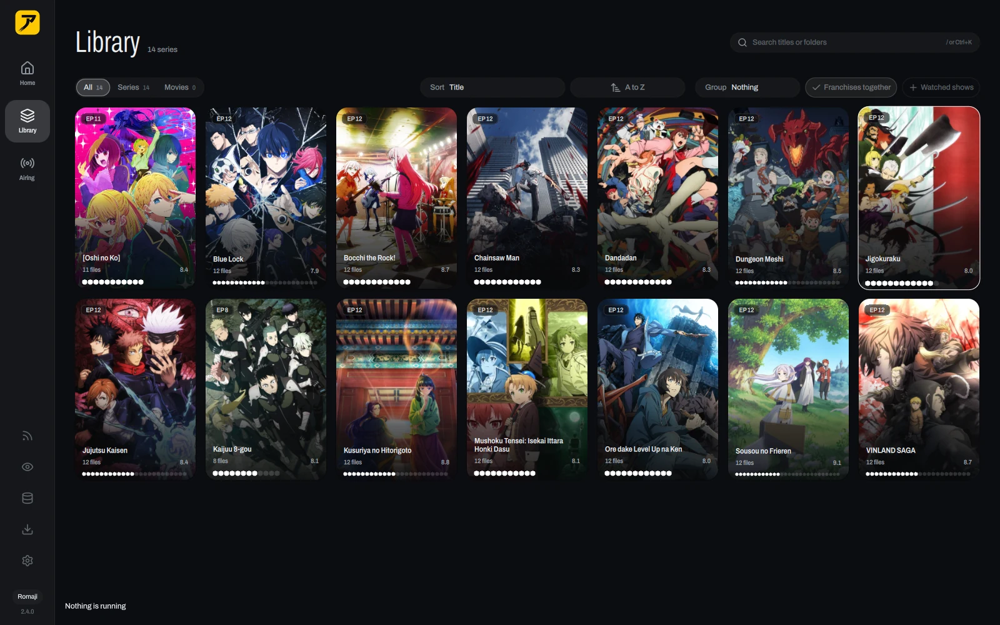

<div align="center">

<picture>
  <source media="(prefers-color-scheme: dark)" srcset="docs/readme/wordmark-dark.svg">
  
</picture>

<br>
<br>

**Your anime folder, as a library you can watch and track.**

<br>

[](https://github.com/marcusbandit/AniBeam/releases/latest)
[](https://github.com/marcusbandit/AniBeam/releases)
[](https://github.com/marcusbandit/AniBeam/releases?q=android&expanded=true)
<br>
[](#install)
[](https://github.com/marcusbandit/AniBeam/releases)
[](LICENSE)
[](https://ko-fi.com/marcusbandit)

</div>

<br>

<div align="center">

</div>

<br>

Point AniBeam at the folder your anime lives in. It finds every show, matches it on
AniList, fetches the posters and airing dates, and plays the episodes right in the window.
Watch most of an episode and it lands on your AniList or MyAnimeList. New episodes can
download by themselves as they come out.

It runs on Linux, Windows and Apple silicon Macs, with a companion app for Android. One
install brings everything it needs: the player, the feed search and a torrent client.

## What's in it

- A library that builds itself. Drop files in the folder and they show up, matched, with
  posters, synopses and what airs next.
- A player in the window, built on mpv. It remembers where you stopped, offers the next
  episode, and every key is one `?` away.
- AniList and MyAnimeList sync. Progress goes both ways, so the cards show where you are.
- Airing: this season's shows, what is out now, and when the next episode lands.
- Downloads with subscriptions. Subscribe to a release once and every new episode arrives
  on its own.
- A franchise graph that shows how sequels, prequels and side stories connect.
- Thirty-five themes, Catppuccin, Gruvbox, Tokyo Night and Nord among them.
- Updates from inside the app, on a Stable or a Nightly track, with a What's new card.
- A phone app that keeps its own library and can stream yours from home over Tailscale.

<table>
  <tr>
    <td width="50%"></td>
    <td width="50%"></td>
  </tr>
  <tr>
    <td align="center"><sub>A series page</sub></td>
    <td align="center"><sub>The whole library</sub></td>
  </tr>
</table>

## Install

Grab the newest version from **[Releases](https://github.com/marcusbandit/AniBeam/releases/latest)**.

| Platform | Get it | Notes |
| --- | --- | --- |
| Any Linux, one line | `curl -fsSL https://anibeam.app/install.sh \| sh` | Picks the right way for your system below: the AUR on Arch, the apt or dnf repo on Ubuntu, Debian and Fedora, the AppImage anywhere else. |
| Arch Linux | `yay -S anibeam-bin` | The release build, installed in seconds. `yay -S anibeam` compiles it instead. Either pulls in anirss and qbittorrent-nox. |
| Ubuntu, Debian | `sudo curl -fsSLo /etc/apt/sources.list.d/anibeam.sources https://anibeam.app/apt/anibeam.sources`<br>`sudo apt update && sudo apt install anibeam` | Ubuntu 24.04, Debian 13 and later. Updates come with `apt upgrade`. |
| Fedora | `sudo dnf config-manager addrepo --from-repofile=https://anibeam.app/rpm/anibeam.repo`<br>`sudo dnf install anibeam` | Fedora 41 and later. Updates come with `dnf upgrade`. |
| Any Linux | `AniBeam-<version>-x86_64.AppImage` | glibc 2.39 or newer: Ubuntu 24.04, Debian 13, Fedora 40 and later. |
| Windows 10 and 11 | `AniBeam-<version>-windows-x64-setup.exe` | Installs for you alone, no admin prompt. A portable `.zip` sits beside it. |
| macOS 15 and later | `brew install --cask marcusbandit/anibeam/anibeam` | Apple silicon. Or download the `.dmg` and drag it into Applications. |
| Android | `AniBeam-<version>.apk` | From the newest `android` release. Sideload it. |

<details>
<summary><b>Mac</b>: Homebrew needs the tap first, and macOS asks once</summary>

<br>

```bash
brew tap marcusbandit/anibeam https://github.com/marcusbandit/AniBeam
brew install --cask marcusbandit/anibeam/anibeam
```

The build is not notarized, so macOS stops the first launch. Go to System Settings >
Privacy & Security, scroll to the AniBeam line and click Open Anyway. From a terminal,
`xattr -dr com.apple.quarantine /Applications/AniBeam.app` does the same.

</details>

<details>
<summary><b>Windows</b>: SmartScreen warns about the unsigned installer</summary>

<br>

If Windows says it protected your PC, click More info, then Run anyway.

</details>

<details>
<summary><b>AppImage</b>: make it executable</summary>

<br>

```bash
chmod +x AniBeam-*-x86_64.AppImage
./AniBeam-*-x86_64.AppImage
```

If it mentions FUSE, install `libfuse2` (`libfuse2t64` on Ubuntu 24.04), or run it with
`--appimage-extract-and-run`.

</details>

After that, the app updates itself. Settings > About picks Stable or Nightly.

## First steps

1. **Add your library.** Click Add a folder on Home and pick your anime folder. One folder
   per show works best: `Anime/Sousou no Frieren/Frieren - 01.mkv`.
2. **Connect a tracker** (optional). Settings > Library > Trackers > Connect, then approve
   AniBeam in the browser.
3. **Watch.** Click a show, then an episode. Space plays and pauses.
4. **Download new episodes** (optional). AniBeam ships with no sources. Add an endpoint
   repo in Settings > Downloads > Endpoint repos, install the sources you want, then
   search a show in Downloads and click Subscribe.

A show AniBeam could not match says "Needs a match". Open it, click Find a match and pick
the right one.

<details>
<summary><b>More on downloads</b></summary>

<br>

AniBeam starts its own anirss, the tool that searches the release feeds. If a qBittorrent of
yours already runs with its Web UI on, AniBeam uses it. If not, it sets up its own the first
time you open Downloads, and that one keeps running after you close the app so
subscriptions keep downloading.

Episodes land in `~/Downloads/Anime` unless you pick another folder. Add that folder to your
library so they show up there.

To use your own qBittorrent, turn on its Web UI (Preferences > Web UI, set a username and
password), then in Settings > Downloads > Torrent client choose Mine, fill in the address and
login, and Save.

</details>

## The phone app

The Android app keeps a library of its own and tracks to the same AniList or MyAnimeList
account. It can also show and play your computer's library from anywhere: turn on Settings >
Library > Phone app > Share over Tailscale on the computer, with
[Tailscale](https://tailscale.com) signed in on both. Only devices on your tailnet can reach
it. [apps/android](apps/android/README.md) has the details.

## When something is off

<details>
<summary><b>Downloads says qBittorrent did not answer</b></summary>

<br>

Open Settings > Downloads > Torrent client and press Test; the State line says what went
wrong. Choosing Pick for me and saving makes AniBeam look again on the next connect.

</details>

<details>
<summary><b>Sign-in stays on "Finish in your browser"</b></summary>

<br>

Approve AniBeam in the browser tab it opened. If that tab is gone, click Open the sign-in
page again.

</details>

<details>
<summary><b>Where AniBeam keeps its data</b></summary>

<br>

| | Data | Tracker tokens | "Use my mpv.conf" reads |
| --- | --- | --- | --- |
| Linux | `~/.local/share/anibeam`, `~/.config/anibeam` | Secret Service keyring, or a file only you can read | `~/.config/mpv/mpv.conf` |
| Mac | `~/Library/Application Support/anibeam` | login keychain | `~/.config/mpv/mpv.conf` |
| Windows | `%LOCALAPPDATA%\anibeam`, `%APPDATA%\anibeam` | Credential Manager | `%APPDATA%\mpv\mpv.conf` |

</details>

Anything else, [open an issue](https://github.com/marcusbandit/AniBeam/issues/new/choose).
A screenshot and the version from Settings > About help a lot.

## Build from source

[docs/build-from-source.md](docs/build-from-source.md) covers building, running from a
checkout and the CLI. [CONTRIBUTING.md](CONTRIBUTING.md) covers issues, pull requests and how
releases ship.

## Support

AniBeam is free and stays free. If it made your anime nights a little nicer and you feel
like buying me a coffee, there is a [Ko-fi](https://ko-fi.com/marcusbandit). It is entirely
optional, and a star or a good bug report helps just as much.

<div align="center">

[](https://ko-fi.com/marcusbandit)

</div>

## Credits

- [AniList](https://anilist.co) and [TVmaze](https://www.tvmaze.com) for the show data,
  [MyAnimeList](https://myanimelist.net) for tracking.
- [mpv](https://mpv.io) and KDE's [MpvQt](https://invent.kde.org/libraries/mpvqt) for the
  player, [Qt](https://www.qt.io) for the window.
- [qBittorrent](https://www.qbittorrent.org) for downloads.

## License

[GPL-3.0](LICENSE).
