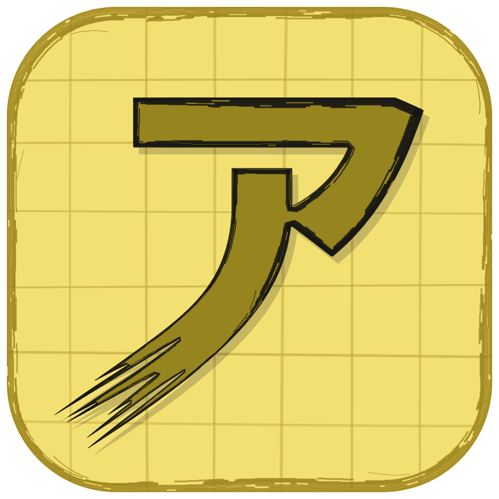

# Logos

| Release | Nightly | Dev |
|:---:|:---:|:---:|
|  |  |  |
| [logo.svg](logo.svg) · [logo.png](logo.png) | [logo-nightly.svg](logo-nightly.svg) · [logo-nightly.png](logo-nightly.png) | [logo-dev.svg](logo-dev.svg) · [logo-dev.png](logo-dev.png) |

The PNGs are 512 px. Each build shows its own: a release the release logo, a nightly (desktop
or iPhone) the nightly one, and a build from source (`./build.sh`, plain cargo or a pull
request's test build) the dev one.

Don't edit these files by hand. `make.py` draws them from `glyph.svg`, with `nightly.py` and
`dev.py` turning the release mark into the other two, and writes every app icon in the repo
in the same run. The website copies them in `site/build.sh`.
